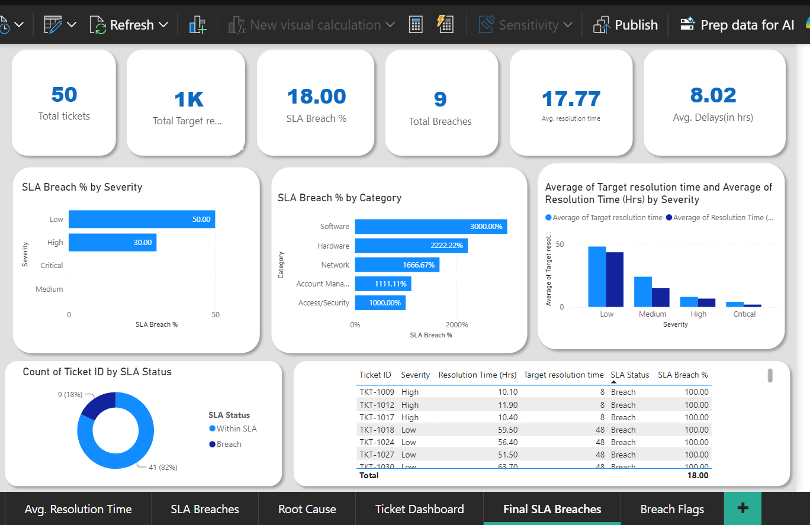

# IT Support Ticket Operations Resolution Analysis
A data analysis project on the IT Helpdesk's tickets.

This project visualises a dashboard summarising the key findings of the "IT Support Ticket Operations Resolution Analysis" project.
Business Problem:

Situation:
The Customer Support department of an e-commerce platform handled over 15,000 incoming support tickets per month across multiple channels (Email, Web Portal, Chat).

Leadership lacked visibility into key operational bottlenecks:
Unresolved ticket backlogs were increasing with no clear tracking of SLA breaches.
High Average Delay Time (AHT) was reducing Customer Satisfaction (CSAT) scores.
Support managers could not identify workload imbalances among agents or high-friction product categories causing ticket spikes.

Task:
  As a Data Analyst, the task was to design, build, and deploy an end-to-end Power BI data solution to:
Consolidate transactional ticket data from flat files.
Define and implement standardized KPIs (Average Resolution Time, SLA Compliance%, SLA Breach).
Provide actionable, role-based dashboards to reduce resolution times and restore SLA compliance above target benchmarks.

Result:
To solve these challenges, an end-to-end data pipeline and BI dashboard were executed in five key phases:
Data Ingestion & Cleansing: Extracted data from the dataset.xlsx file
Data Modeling: Designed tables and created active relationships between ticket_raw_data and "SLA compliance" tables.
DAX Metric Calculation: Engineered DAX measures for core metrics.

BusinessProblem.md file describes some common business questions and answers.
Challenges.md file describes
TicketSummary.png contains the dashboard's homepage.
SLA.png contains the SLA related charts.
dataset.xlsx is the source raw data used for the project. It has less data because it is dummy data. Real Power BI can process more than 15000 records.
powerBI.pbix is the project's code.

